<p align="center">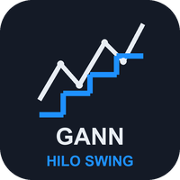</p>

# Gann HiLo Swing (MetaTrader 5 and MetaTrader 4)

A free indicator with two of W.D. Gann's simple tools on **closed bars only**: the **HiLo Activator** line (blue in an
uptrend, red in a downtrend) and the **2-bar swing chart** (a dotted line through confirmed swing highs and lows), with an
arrow and an alert on the bar where a new trend starts. Source for both editions, a Python reference of the rules, and the
tests that were used to check that the MT5 and MT4 code, the Python reference and each other all agree.

**Website:** [allanninal.dev/mql5 (indicators)](https://www.allanninal.dev/mql5/#indicators) · [MT4 editions](https://www.allanninal.dev/mql5/#mt4) · [allanninal.dev](https://www.allanninal.dev)
· **Contact:** message me on [LinkedIn](https://www.linkedin.com/in/allanninal/).

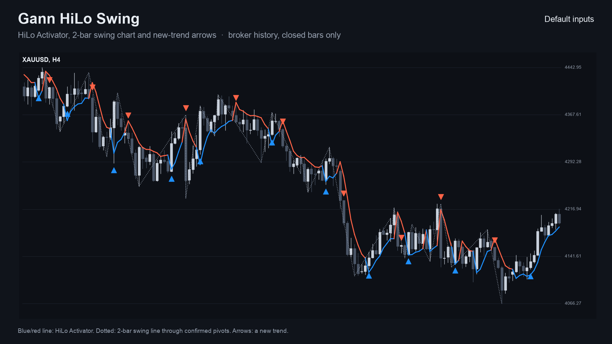

> It is an indicator, not a strategy. It draws a line and arrows and places no trades. Nothing here is a profit claim
> (see [Honest limits](#honest-limits)).

## Get it on the MQL5 Market

| Edition | Platform | Price | Link |
|---|---|---|---|
| Gann HiLo Swing | MT5 | free | <https://www.mql5.com/en/market/product/201806> |
| Gann HiLo Swing MT4 | MT4 | free | <https://www.mql5.com/en/market/product/202367> |
| Gann Toolkit | MT5 | paid | <https://www.mql5.com/en/market/product/201807> |
| Gann Toolkit MT4 | MT4 | paid | <https://www.mql5.com/en/market/product/202424> |

The Market builds are the same calculation as the source in this repository. The two toolkit editions are a separate,
paid product that is **not** part of this repository (see [Free vs Pro](#free-vs-pro)).

## Contents

1. [What it is and who it is for](#what-it-is-and-who-it-is-for)
2. [Why it was built](#why-it-was-built)
3. [How it works](#how-it-works)
4. [Non-repainting: the proof and how it was tested](#non-repainting-the-proof-and-how-it-was-tested)
5. [Architecture and buffers](#architecture-and-buffers)
6. [Inputs, alerts, install and compile](#inputs-alerts-install-and-compile)
7. [Run the Python reference and the tests](#run-the-python-reference-and-the-tests)
8. [Honest limits](#honest-limits)
9. [Free vs Pro](#free-vs-pro)
10. [Licence](#licence)

## What it is and who it is for

**What:** the HiLo Activator with Gann's own period of 3, plus the 2-bar swing chart. The line shows the trend side; the
dotted swing line connects confirmed pivots; an arrow marks the bar where a **new trend** starts (the activator and the
swing agree on a new side; the swing condition can be switched off). Alerts: pop-up (on by default), sound, push
notification, e-mail.

**For:** traders who read the trend with Gann's simple tools. Also for developers who want a small, tested trend engine
with documented buffers to read from an EA with `iCustom`.

**Not for:** anyone who expects the arrows to be entries that win. Period 3 follows price closely and flips often.

| | |
|---|---|
| 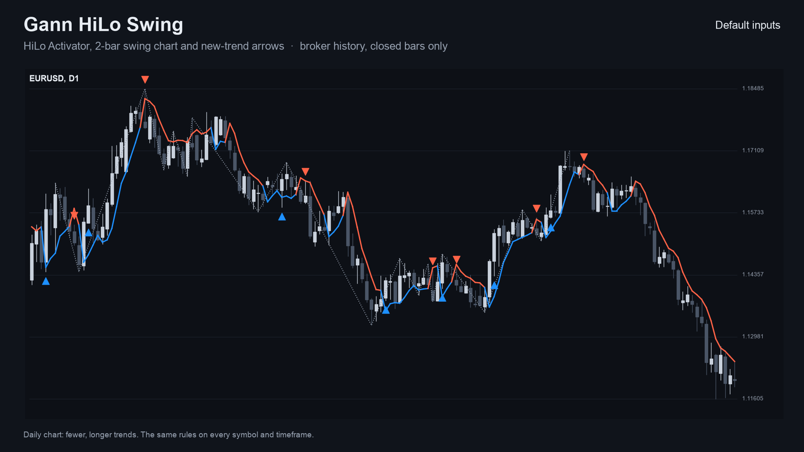 | 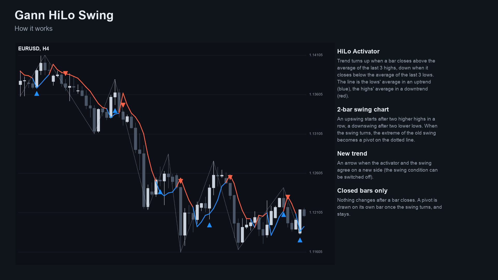 |
| 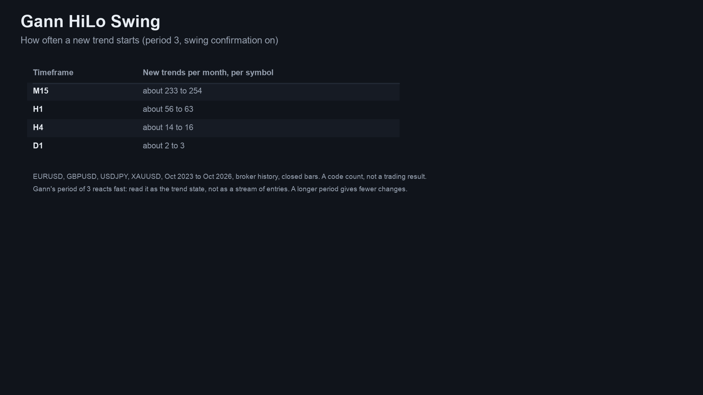 | 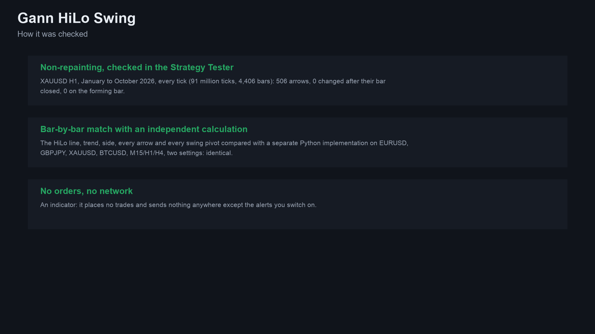 |
| 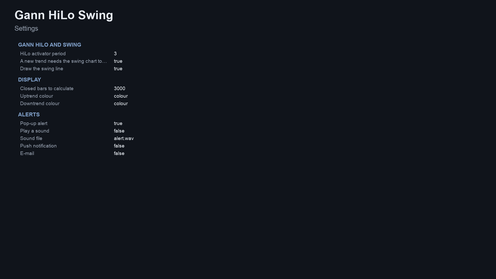 | |

Image notes: the charts are drawn by the Python reference on broker price history (the same numbers the indicator shows);
the explanation, frequency, checks and settings sheets are illustrations, not terminal captures. MT4 versions are in
[`docs/images/mt4/`](docs/images/mt4).

## Why it was built

The HiLo Activator and the 2-bar swing chart are classic, simple tools that are rarely offered as a plain, readable
indicator with alerts. The motivations, stated with the evidence we actually have:

- **Readable rules.** Both tools are a few lines of arithmetic, in [`tests/reference.py`](tests/reference.py) and in the
  `.mqh` engine.
- **Trust in the line.** Everything is calculated from closed bars, so nothing on the chart changes after its bar has
  closed. A swing pivot is drawn on its own bar once the swing has turned and never moves.
- **Honest scale of demand.** Our market research (October 2026) found Gann is the best-priced classic method on the MQL5
  Market (about 119 Gann indicators, 16 of them free), but buyers mostly want Gann *levels and geometry*; plain HiLo
  products sell poorly. So this is a free reference tool, not a claim of demand for HiLo arrows.
- **No edge claimed.** An expert advisor that traded these same rules was tested out of sample and did not pass (0 of 37
  settings), which is why this is published as a chart tool and not as a signal.
- **Provable behaviour.** Every number in this README comes from an executed check, listed below.

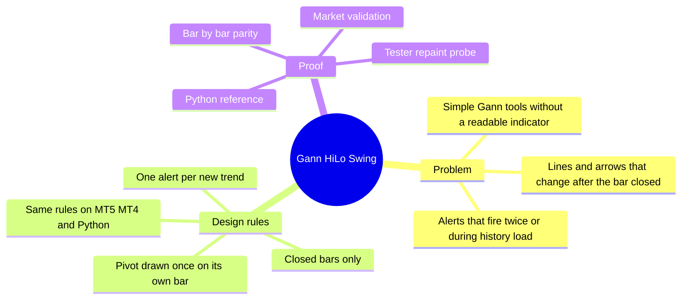

## How it works

### The rules, step by step

`H, L, C` are a bar's high, low, close; `N` is the HiLo period (default 3); bars are numbered oldest first.

**HiLo Activator**

1. `avgHigh[k]`, `avgLow[k]` = simple averages of the last `N` highs and lows, ending at bar `k`.
2. The trend is decided with the averages **as of the bar before**: the trend turns **up** if `C[k] - avgHigh[k-1] > eps`,
   **down** if `avgLow[k-1] - C[k] > eps` (`eps = 1e-9 x C`); otherwise it is unchanged.
3. The line is `avgLow[k]` in an uptrend and `avgHigh[k]` in a downtrend. Nothing is drawn before `N` bars exist.

**2-bar swing chart**

1. An **upswing** starts when `H[k] > H[k-1] > H[k-2]` (two higher highs in a row); a **downswing** when
   `L[k] < L[k-1] < L[k-2]`. If both happen on one bar, the close decides (`C[k] > C[k-1]` means up).
2. When the swing turns up, the lowest low of the downswing (this bar included) becomes a **swing-low pivot**, confirmed on
   this bar and drawn on the bar where that low was; a turn down mirrors it with a swing-high pivot. The first swing
   direction creates no pivot.

**Side and new trend**

- With the swing condition on (default) the side is `+1` when the activator is up **and** the swing is up, `-1` when both
  are down, and otherwise keeps its previous value. With it off the side is the activator trend.
- A **new trend** is a change of side from a non-zero side, after at least `N + 2` bars. It gets the arrow and the alert.

### Per-bar algorithm

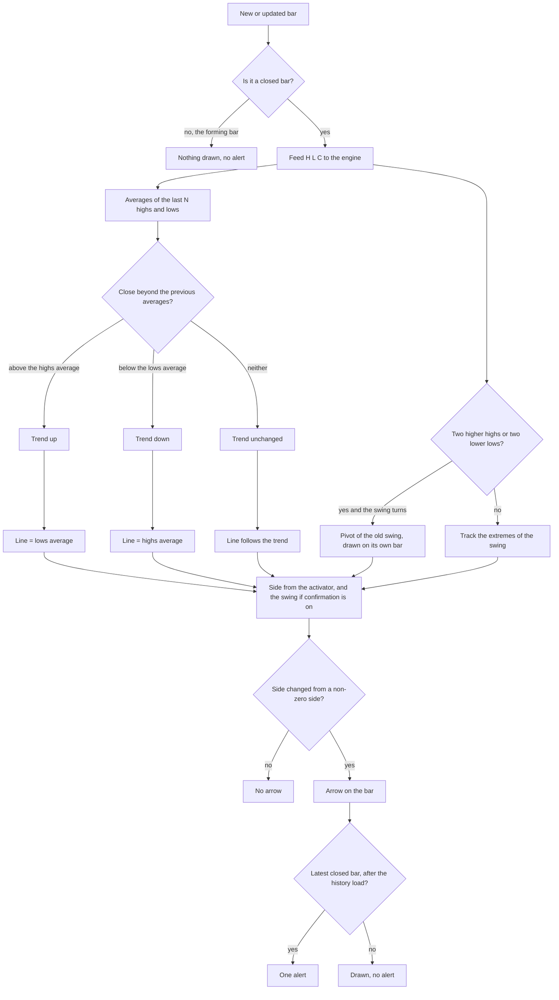

### Trend states

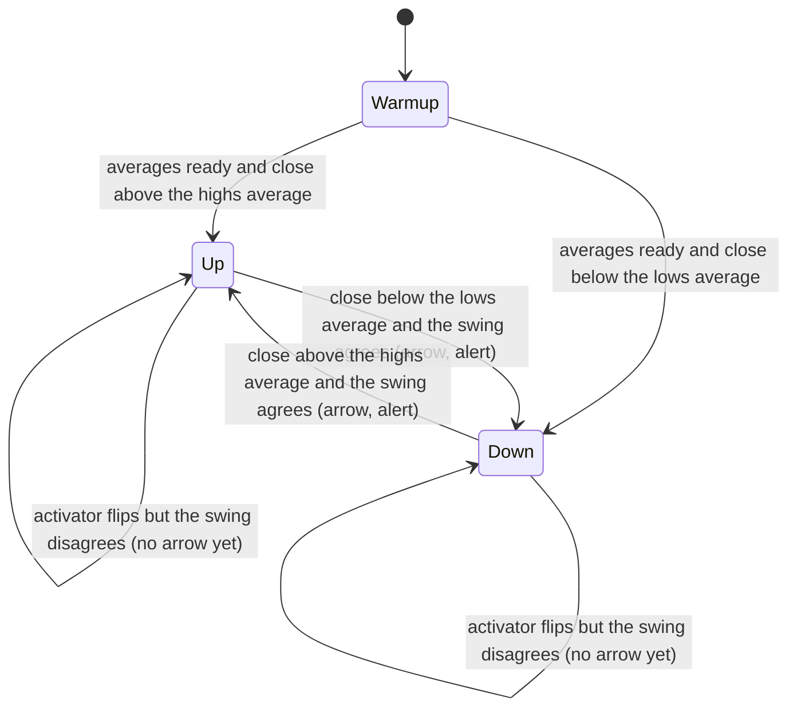

### Alert flow

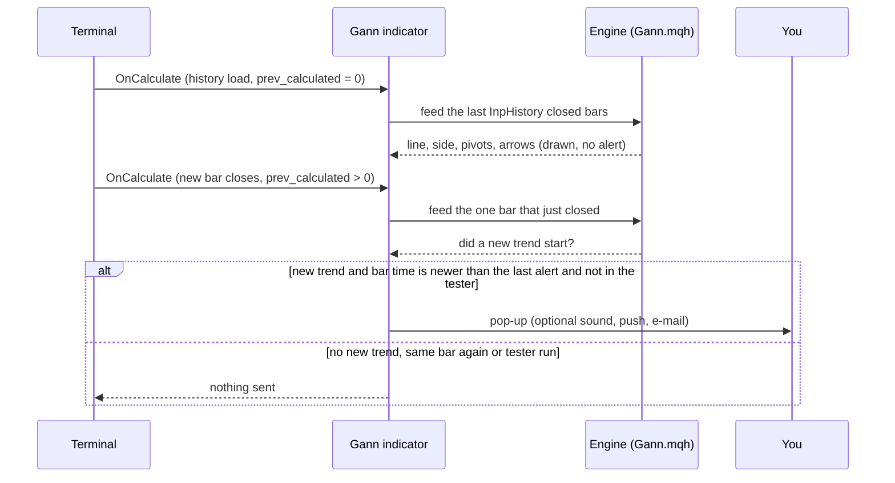

### How often a new trend starts (measured)

New trends per 1,000 closed bars, default inputs (period 3, swing confirmation on), on broker history of EURUSD, GBPJPY,
XAUUSD and BTCUSD (H1: 284,859 bars; H4: 72,039; M15: 19,112 because the M15 history in the tester was shorter). It counts
trend changes only, not what price does afterwards. Source: [`docs/data/trend-frequency.json`](docs/data/trend-frequency.json),
made by [`tests/frequency.py`](tests/frequency.py).

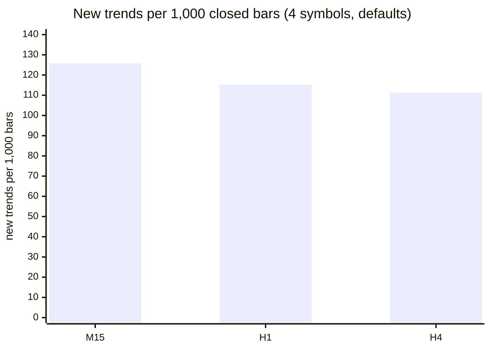

About one new trend every 8 to 9 bars on every timeframe. This is why the arrows should be read as the trend state, not as
a stream of entries; a longer period gives fewer changes.

## Non-repainting: the proof and how it was tested

"Non-repainting" is easy to claim. Here is what was actually run. Raw result files are in [`tests/results/`](tests/results).

**1. Implementations compared bar by bar.** The Python reference ([`tests/reference.py`](tests/reference.py)) holds the rules, operation for operation. The MT5 and MT4 indicators were dumped bar by bar (every buffer) in the MetaTrader Strategy Tester (MT4) or by a script (MT5), and [`tests/check_parity.py`](tests/check_parity.py) compared each dump with the reference: line, side, trend, arrows and swing pivots must be identical on every closed bar.

Run on this exact code: compile 0 errors, 0 warnings (both editions); MT5 24 dumps and MT4 25 dumps (EURUSD, GBPJPY, XAUUSD, BTCUSD on M15, H1 and H4 with the repository's input sets; MT4 adds an every-tick run on EURUSD H1), all identical to the reference on every closed bar; the repaint probes found 0 closed bars that changed afterwards.

**The wider matrix**, made with the Market builds before this repository was cut from them (the same calculation; four symbols EURUSD, GBPJPY, XAUUSD, BTCUSD, M15, H1 and H4, the repository's input sets), checked here against the same reference:

| | MT5 | MT4 |
|---|---|---|
| dumps compared | 24 | 25 |
| bars compared | 72,000 | 509,548 |
| failures | 0 | 0 |
| result | ALL PASS | ALL PASS |

Sources: [`tests/results/parity-wide-run-mt5.txt`](tests/results/parity-wide-run-mt5.txt), [`tests/results/parity-wide-run-mt4.txt`](tests/results/parity-wide-run-mt4.txt). MT5 history starts later than MT4's test history on some pairs, which is why the bar counts differ.

**2. Repaint probe.** An EA records which signal buffers are set on each bar *at the moment it closes*, then reads the same bars again at the end and counts any value that changed. It also counts any signal ever shown on the still-forming bar.

| Run | Closed bars checked | Signals seen at close | Changed afterwards | Signals on the live bar |
|---|---|---|---|---|
| MT5, Market build, XAUUSD H1, every tick, 91,052,717 ticks | 4,406 | 506 | **0** | **0** |
| MT4, Market build, 25 runs combined | 506,172 | 60,813 | **0** | **0** |

Source: [`tests/results/repaint-summary.md`](tests/results/repaint-summary.md). The MT5 probe was run once per build on one symbol and timeframe; the MT4 probe ran on every dump run.

**3. Market validation.** Both Market builds passed the MQL5 Market's automated product validation before publication (this is the Market's own check, not part of this repository).

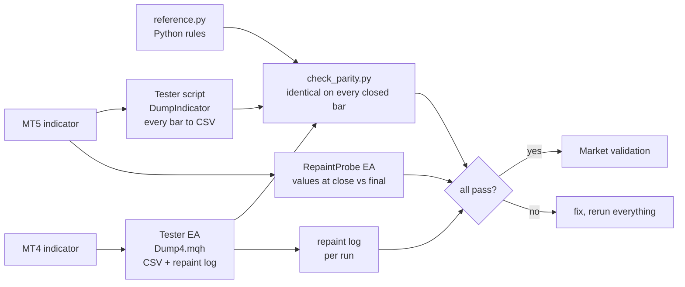


### Why the design cannot repaint

- The engine is fed only bars up to `rates_total - 2`, i.e. never the forming bar.
- Each decision uses that bar and earlier bars only. The activator compares the close with averages ending at the bar before.
- A swing pivot is *confirmed* on the bar where the swing turns and is written to the (earlier) bar where the extreme was.
  It is written once and never moves; the MT4 test therefore re-reads the swing buffer for the last 100 bars at every new bar
  to prove that nothing changes afterwards.
- Alerts fire only for the bar that just closed, only after the history load, once per bar, and never in the tester.

## Architecture and buffers

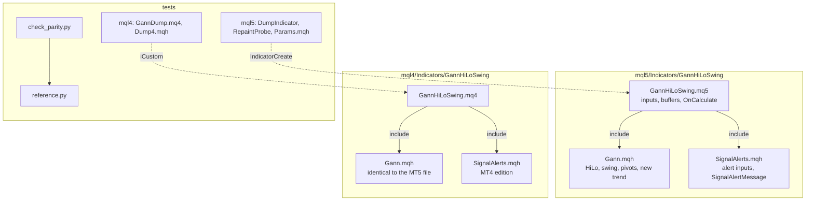

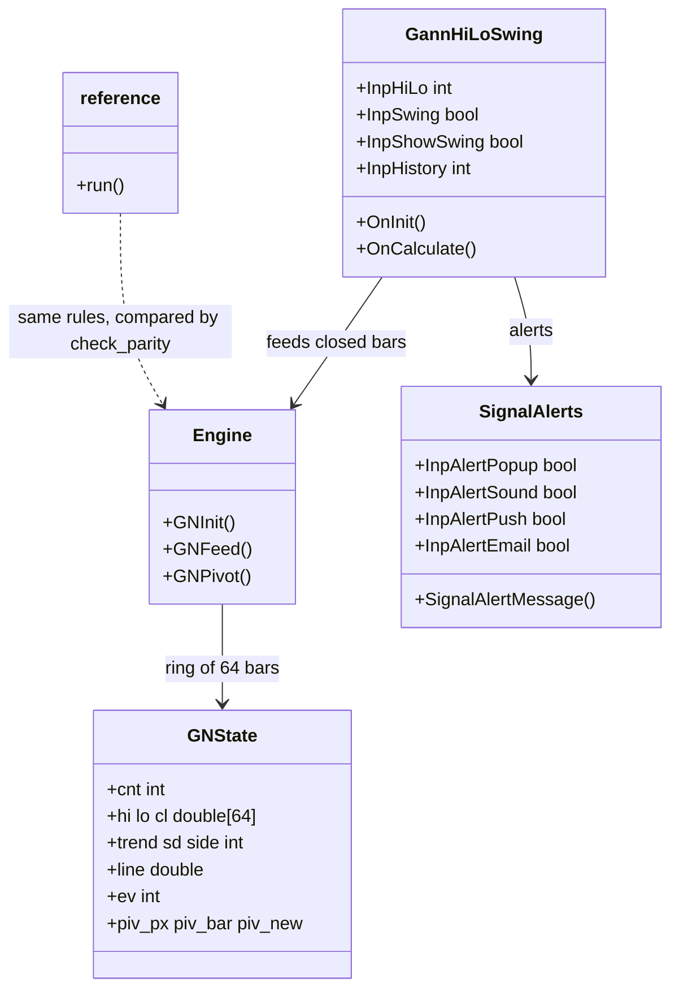

### `iCustom` buffer table (for EA developers)

| Buffer | MT5 | MT4 |
|---|---|---|
| 0 | **New uptrend** arrow price (bar low), empty otherwise | same (below the low on MT4) |
| 1 | **New downtrend** arrow price (bar high), empty otherwise | same (above the high on MT4) |
| 2 | HiLo line | HiLo line (not drawn; read this one) |
| 3 | colour index of the line (0 up, 1 down) | same value; the drawn line uses buffers 7 and 8 |
| 4 | swing line: the pivot price, on the pivot's own bar | same |
| 5 | side (+1, -1, 0) | same |
| 6 | activator trend (+1, -1, 0) | same |

Empty value is `EMPTY_VALUE`. Read values on **closed bars** (shift 1 and higher). `iCustom` parameters follow the input
order: HiLo period, swing condition, draw the swing line, history, up colour, down colour, (MT4 only: arrow gap), pop-up,
sound, sound file, push, e-mail. In MT5 the `input group` headings also count as string parameters when you build a handle
with `IndicatorCreate` (see `tests/mql5/Include/IndTest/Params.mqh` and the strings in `tests/check_parity.py`).

## Inputs, alerts, install and compile

| Input | Default | Meaning |
|---|---|---|
| HiLo activator period | 3 (1-50) | Gann's own is 3; longer gives fewer trend changes |
| A new trend needs the swing chart to agree | true | Off: the side is the activator trend alone |
| Draw the swing line | true | Show or hide the dotted line |
| Closed bars to calculate | 3000 (200-50000) | How far back the chart is drawn |
| Uptrend colour, Downtrend colour | blue, red | Look only |
| Arrow distance from the candle (MT4 only) | 0.3 x ATR(14) | MT4 cannot shift arrows by pixels |
| Pop-up alert | true | Terminal alert window |
| Play a sound / sound file | false / alert.wav | File from the terminal's Sounds folder |
| Push notification | false | Needs your MetaQuotes ID in Options |
| E-mail | false | Needs e-mail set up in Options |

**Install from source.** Copy `mql5/Indicators/GannHiLoSwing/` into `<terminal data folder>/MQL5/Indicators/` (MT5) or
`mql4/Indicators/GannHiLoSwing/` into `<data folder>/MQL4/Indicators/` (MT4), open the `.mq5` or `.mq4` in MetaEditor and
press Compile (F7). Both compile with 0 errors and 0 warnings (checked on a Windows machine with MetaEditor, from a clean scratch folder that holds only these files; the compiled files are not in the repository).
Keep the three files of each edition together: the indicator includes `Gann.mqh` and `SignalAlerts.mqh` from its own folder.

## Run the Python reference and the tests

```bash
python3 -m venv .venv && . .venv/bin/activate && pip install -r requirements.txt
```

```python
import sys; sys.path.insert(0, "tests")
from reference import run
# h, l, c are float lists of closed bars, oldest first
rows, pivots = run(h, l, c, hilo=3, swing_confirm=True)   # rows[k]: line, trend, side, sd, ev (+1/-1 new trend)
```

To repeat the parity check on your own data:

1. Compile the indicator and the test tool for your platform (`tests/mql5/Scripts/DumpIndicator`, or
   `tests/mql4/GannDump.mq4` with `tests/mql4/Include/IndTest4/Dump4.mqh` in your `MQL4/Include/IndTest4/`; MT5 also needs
   `tests/mql5/Include/IndTest/Params.mqh`).
2. Run it in the Strategy Tester (MT4) or as a script (MT5) for each symbol and timeframe, with the input sets in
   `tests/configs.tsv` (MT5; the exact `InpParams` strings are in `tests/check_parity.py`) and `tests/mql4/configs.tsv`
   (MT4). The tool writes one CSV per symbol and timeframe into a `dump` folder.
3. `python3 tests/check_parity.py <folder that contains dump>` (add `--mt4` for MT4 dumps). It prints PASS or FAIL per file
   and an overall result.
4. Repaint: run `tests/mql5/Experts/RepaintProbe` in the MT5 Strategy Tester (every tick); the MT4 test EA writes its
   repaint log with the dump.

The price dumps used for the published numbers are not in this repository (they are broker price data).

## Honest limits

- **A trend line is not a strategy.** No stop-loss, position sizing or exit rules are provided or implied, and the rules
  were not optimised or back-tested for profit. An expert advisor built on these rules did not pass out-of-sample testing.
- **No profit or accuracy claim is made.** The only numbers here are about *consistency* (the implementations agree, lines
  and arrows do not move) and *frequency* (new trends per 1,000 bars).
- **Fast by design.** Period 3 follows price closely: about one new trend every 8 to 9 bars. Raise the period or the
  timeframe for fewer changes; sideways markets produce many.
- **Lag.** A trend change is confirmed by a close beyond an average, and a swing pivot is known only when the swing turns.
- **One reading of Gann.** Gann's tools have several modern interpretations; these are the rules stated above.
- **Scope of the tests.** Four symbols on M15, H1 and H4 for the Market builds (the same calculation), the repository's input sets, one MT5 repaint run; the code in this repository has so far been compile-checked only, and the MT5 build was not run on a live chart as part of these numbers. Other symbols and timeframes are not covered by the published numbers.
- Further Gann tools drawn from these swings exist as a separate paid product (see below).

## Free vs Pro

| | Free: Gann HiLo Swing | Paid: Gann Toolkit |
|---|---|---|
| Platforms | MT5 [201806](https://www.mql5.com/en/market/product/201806), MT4 [202367](https://www.mql5.com/en/market/product/202367) | MT5 [201807](https://www.mql5.com/en/market/product/201807), MT4 [202424](https://www.mql5.com/en/market/product/202424) |
| Price | free | paid (see the Market page) |
| What you get | HiLo line, swing line, new-trend arrows and alerts on the current chart, source here | More Gann tools built on the same engine, as described on its Market listing |
| Source | this repository | not published |
| Closed-bar lines and arrows, no repaint | yes | see its listing |

No need to buy the paid product to use the free one: the free indicator is complete on its own.
Website: [allanninal.dev/mql5](https://www.allanninal.dev/mql5/#indicators) ([MT4](https://www.allanninal.dev/mql5/#mt4)).

## Licence

Copyright 2026 Allan Niñal (<https://www.allanninal.dev/mql5>). Licensed under the
[PolyForm Noncommercial License 1.0.0](LICENSES/PolyForm-Noncommercial-1.0.0.md): source-available, free for personal
and other noncommercial use, not for commercial use. Each source file has an `SPDX-License-Identifier` line. Text:
[`LICENSE`](LICENSE). The HiLo Activator and the 2-bar swing chart are classic, publicly described methods; the code is
original. The licence applies to this source, not to anything you build or trade with the indicator. Trading involves risk;
the software is provided as is.

---

**Website:** [allanninal.dev/mql5](https://www.allanninal.dev/mql5/#indicators) · [MT4](https://www.allanninal.dev/mql5/#mt4) · [allanninal.dev](https://www.allanninal.dev)
· Questions: message me on [LinkedIn](https://www.linkedin.com/in/allanninal/).
